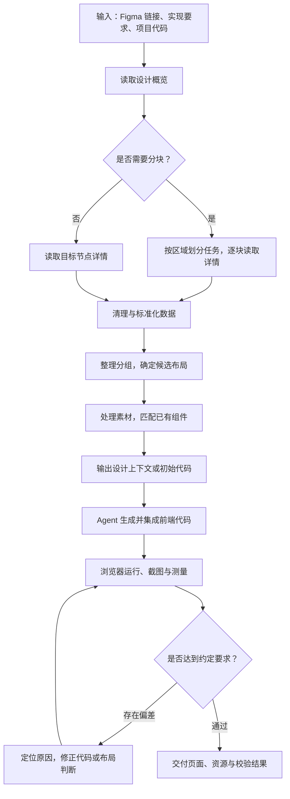

# AI Agent D2C 流程

本文按执行顺序整理从 Figma 设计稿到前端页面的处理流程。各步骤可由 D2C 工具与 Agent 配合完成，具体分工取决于工具能力。

## 1. 确定范围并读取设计

**执行方：Agent + D2C 工具。**

1. 接收 Figma 链接，确定需要实现的页面或区域。
2. 读取项目技术栈、组件库、样式约定和实现要求。
3. 获取设计整体结构、参考截图和共用样式。
4. 根据目标范围读取文字、位置、尺寸、布局设置、组件引用和素材信息。

**输出：** 目标范围、设计概览、参考截图和项目约束。

Figma 官方 MCP 可通过 `get_metadata` 获取简要结构，再通过 `get_design_context` 和 `get_screenshot` 获取设计上下文与截图。[官方工具文档](https://developers.figma.com/docs/figma-mcp-server/tools-and-prompts/)

## 2. 按需拆分大节点，分批读取

**执行方：Agent 或具备自动分块能力的 D2C 工具。**

1. 根据节点数量、预估数据量和读取耗时，判断是否需要分块。
2. 优先按导航、侧栏、内容区、卡片等完整区域划分任务。
3. 对每个区域分别读取详细数据；仍然过大的区域继续细分。
4. 为各块保留父容器布局、全局样式、相邻区域间距、遮挡和裁剪关系。
5. 记录各块的完成、失败和待处理状态，避免遗漏或重复。

如果整张截图过长，可配合局部截图检查细节。读取阶段已经超时时，应缩小请求范围后重试，不能依靠截断返回内容完成处理。

**输出：** 覆盖目标页面的分块数据，以及各块之间的关系。

这一步通常不需要修改 Figma 原稿。官方 MCP 支持先读取结构，再由 Agent 按子节点获取详情；是否自动拆分取决于工作流实现。[分批读取说明](https://developers.figma.com/docs/figma-mcp-server/tools-and-prompts/#get_metadata)

## 3. 清理并标准化数据

**执行方：D2C 工具中的处理程序。**

1. 保留原始节点标识、文字、位置、尺寸、样式和素材引用。
2. 统一坐标与属性表达，保留必要的父子变换关系。
3. 提取重复样式，整理重复资源。
4. 在确认不影响布局和显示后，清理冗余图层。
5. 保留影响间距、尺寸、遮挡、裁剪和目标状态的结构。
6. 分开记录设计中读取到的事实与后续推断结果。

**输出：** 可供布局分析与代码生成使用的统一设计数据。

## 4. 整理分组并确定候选布局

**执行方：布局处理程序；有歧义时由视觉模型或 Agent 辅助。**

1. 优先使用设计中已有的排列、尺寸、间距和对齐规则。
2. 原始层级不合理时，先保留实际位置、样式、遮挡和裁剪信息。
3. 根据靠近、对齐、包含、重复和空白区域提出分组候选。
4. 根据候选分组推断横排、纵排、网格或覆盖布局。
5. 结合截图判断卡片归属、角标附着、浮层覆盖等语义关系。
6. 将候选结构关联到原始节点，留待渲染验证。

**输出：** 页面与组件的候选结构、布局参数，以及尚未确认的判断。

货拉拉的开源实现包含图层清理、投影分组和布局计算，可作为这一步的实现参考。[项目处理流程](https://github.com/HuolalaTech/huolala-figma-mcp)

## 5. 准备素材并匹配已有组件

**执行方：D2C 工具 + Agent。**

1. 导出图片和图标，选择适当的资源格式。
2. 去除重复资源，记录资源路径与来源。
3. 确认项目能够使用设计所需的字体。
4. 查找设计组件对应的已有代码组件。
5. 映射组件属性、状态、文字和设计变量；缺少明确映射时记录候选。

**输出：** 可用素材、组件映射和样式变量。

组件映射可由 Figma Code Connect 等机制提供。[组件映射工具说明](https://developers.figma.com/docs/figma-mcp-server/tools-and-prompts/#get_code_connect_map)

## 6. 输出当前任务需要的设计信息

**执行方：D2C 工具。**

按当前处理区域组织输出：

- 参考截图与必要的局部截图。
- 整理后的结构、布局参数、文字和样式。
- 素材路径与组件映射。
- 父容器、相邻区域及跨区域元素的关系。
- 原始节点来源和未确认的判断。
- 工具支持时生成的初始 HTML/CSS。

**输出：** Agent 可用于实现当前区域的设计上下文或初始代码。

## 7. Agent 生成并集成代码

**执行方：AI Agent。**

1. 按项目规范创建或修改页面文件。
2. 复用已有组件，实现布局与样式。
3. 接入图片、图标、字体和已明确的数据及交互逻辑。
4. 组合各区域，统一处理页面级布局和跨区域元素。
5. 核对内容覆盖情况，保留重复组件各实例的差异。
6. 对没有设计依据的关键响应式或交互行为补充需求，或明确记录实现假设。

**输出：** 已接入项目、可以运行的前端页面。

## 8. 渲染、校验并循环修正

**执行方：浏览器、比较程序与 Agent。**

1. 启动页面，检查构建、运行和资源加载情况。
2. 将视口、页面内容和交互状态对齐参考设计，等待字体与图片加载完成。
3. 获取页面截图，测量关键元素的位置、尺寸、间距和溢出情况。
4. 结合图像对比和视觉模型判断，定位缺失、错位、颜色、文字与遮挡问题。
5. 根据设计数据、代码和浏览器测量分析原因，再修改对应实现。
6. 重新渲染，确认目标区域改善且没有引入新的偏差。
7. 检查整页组合效果，并验证已约定的长文本、窄屏和交互场景。
8. 达到约定要求后，交付页面、资源与校验结果，注明仍未解决的问题。

校验时保留每轮结果，避免后续修改破坏已有正确部分。视觉模型的判断需要结合测量和实际渲染证据；若多轮没有改善，应回查设计数据、素材、字体或布局假设。
